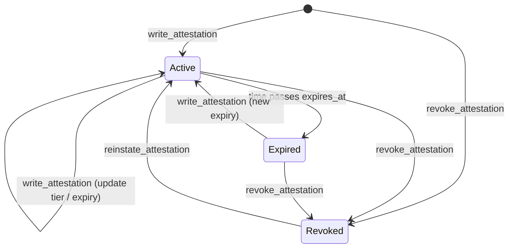
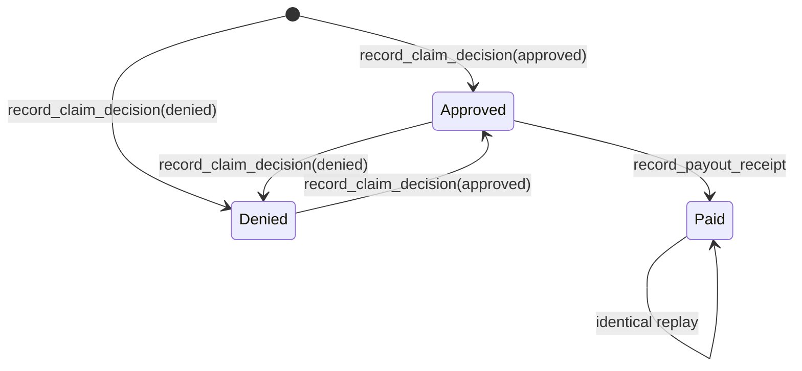
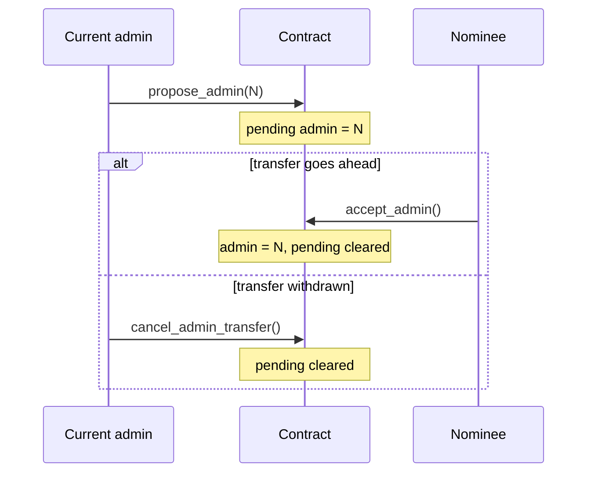

# Overview

This page explains the concepts shared by both contracts. For exact signatures, see the [contract reference](INTERFACES.md).

## Roles

| Role | Who | Can do |
|---|---|---|
| **Admin** | One Stellar address, set at deployment | Write records, nominate a new admin, upgrade the contract |
| **Nominee** | The address the admin proposes | Accept the admin role |
| **Anyone** | Any account | Read records, check validity, extend storage lifetime |

The admin can be an ordinary account, a [multisig account](https://developers.stellar.org/docs/learn/encyclopedia/security/signatures-multisig) or a contract. Authorization follows the address's own rules.

## KYB Attestation Registry

An **attestation** records the KYB standing of one Stellar address, called the **subject**:

| Field | Meaning |
|---|---|
| `tier` | A short code for the level of review, for example `standard` |
| `expires_at` | When the standing lapses (Unix seconds) |
| `revoked` | Whether the standing has been withdrawn |

A subject is **valid** when an attestation exists, it is not revoked, and `expires_at` is in the future. `is_valid(subject)` performs this check.

### Lifecycle

- **Revoked is sticky.** Only `reinstate_attestation` leaves the Revoked state. `write_attestation` on a revoked subject fails.
- Revoking a subject that has never been attested records it as revoked. A later `write_attestation` for that subject then fails as well.

## Insurance Record

The Insurance Record links three kinds of commitment through 32-byte identifiers:

| Record | Key | Holds |
|---|---|---|
| **Policy** | `deal_id` | `escrow_id`, `policy_hash`, `status` |
| **Claim** | `claim_id` | `deal_id`, `decision`, `decision_hash`, optional `receipt_hash` |

Hashes are SHA-256 commitments to documents or records held off-chain. The contract stores only the digest. Anyone who holds the original can recompute the digest and compare it.

### Claim lifecycle

- A claim stays bound to the `deal_id` it was first recorded with.
- A payout receipt can be attached only to an **approved** claim.
- Once paid, the decision and the receipt are final. Only an identical replay is accepted.

## Admin transfer

The admin does not change until the nominee accepts. This prevents handing the role to an address that nobody controls.

## Storage lifetime

Soroban storage entries have a time-to-live (TTL). Each write extends the record it writes, to about 120 days, and the contract instance, to about 30 days. Anyone can extend them further; see [Deployment and operations](DEPLOYMENT.md#maintain-storage-lifetime).

## Events

Every state change publishes a contract event: writes, revocations, reinstatements, decisions, payouts, admin transfers and upgrades. Indexers can rebuild the complete history from events. See the [event reference](INTERFACES.md#events).
